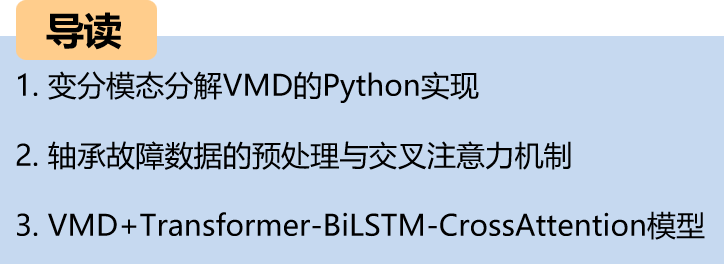
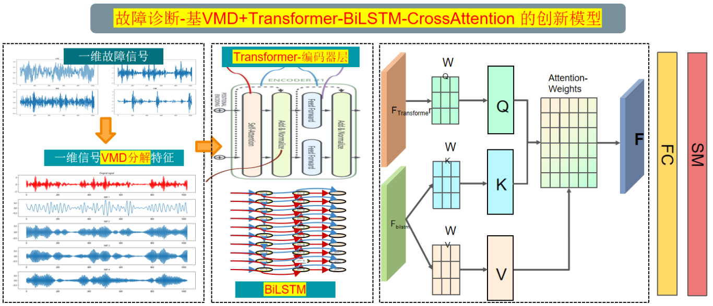
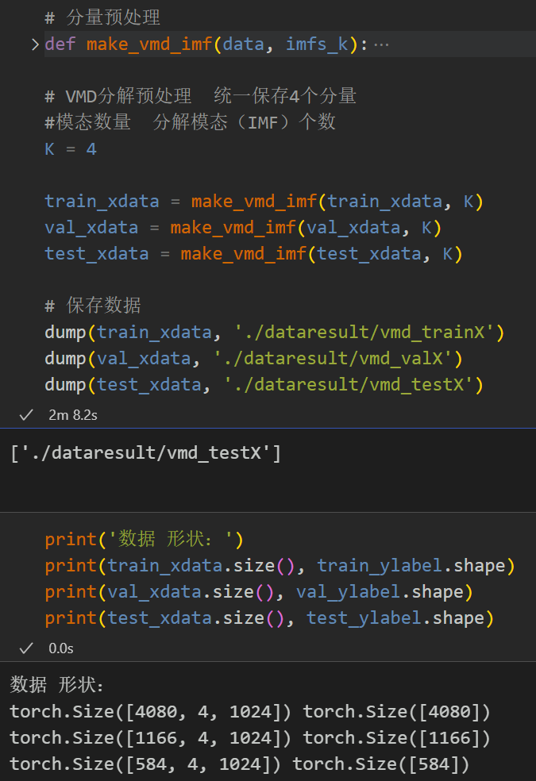
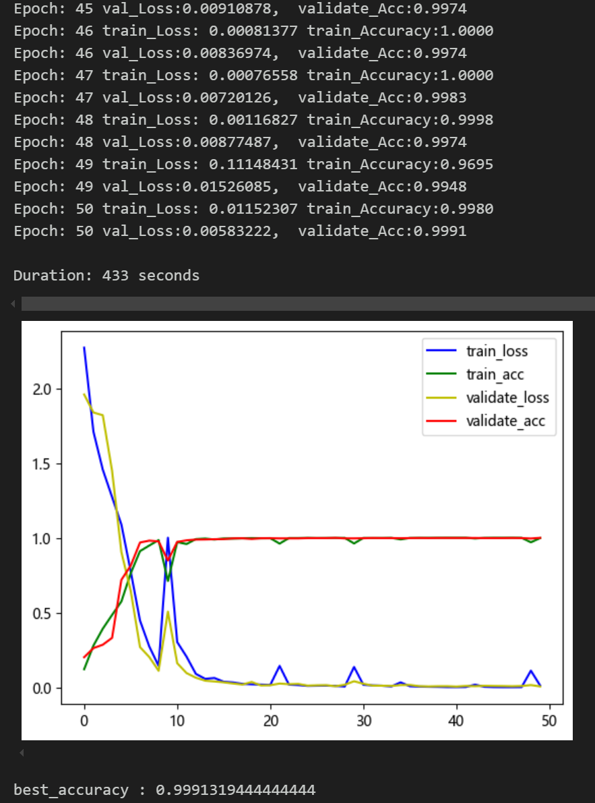
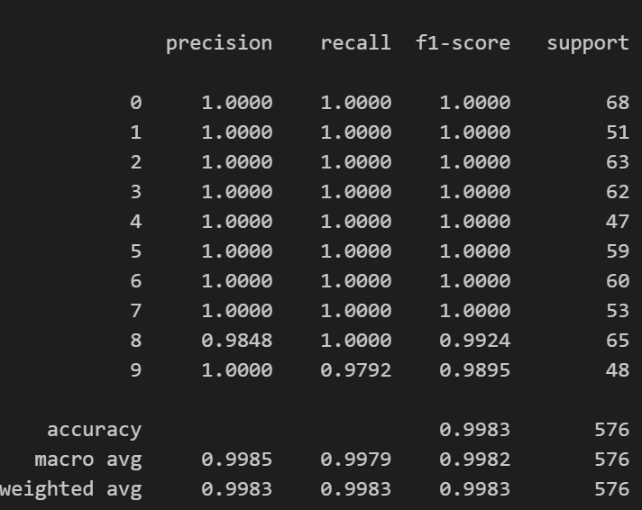
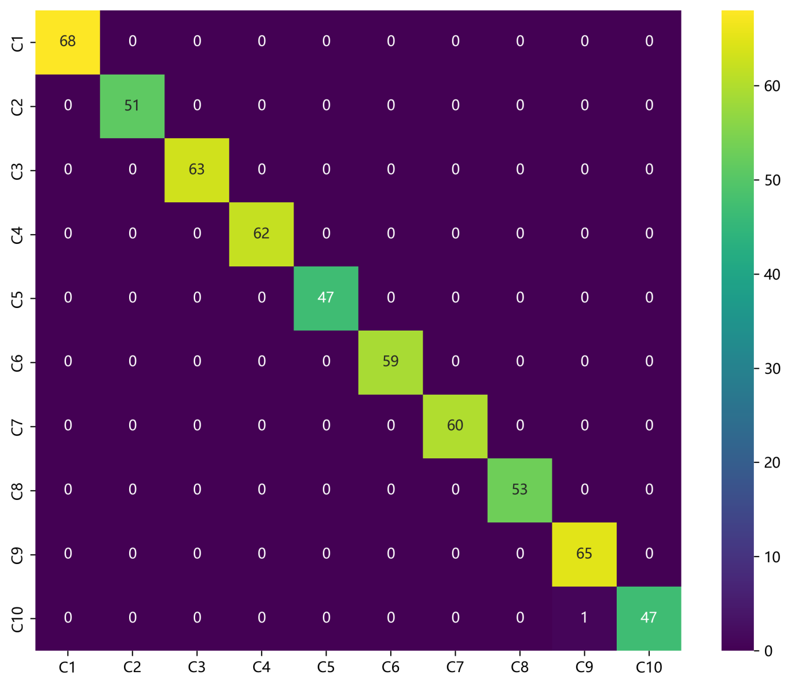
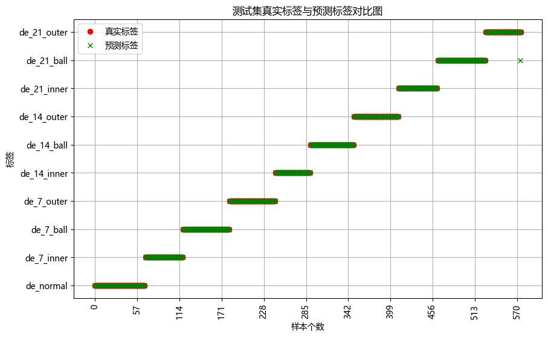
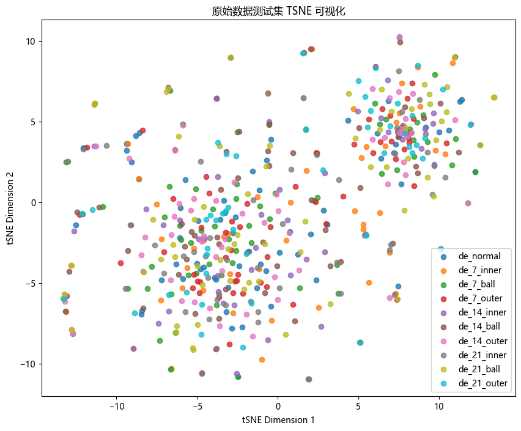
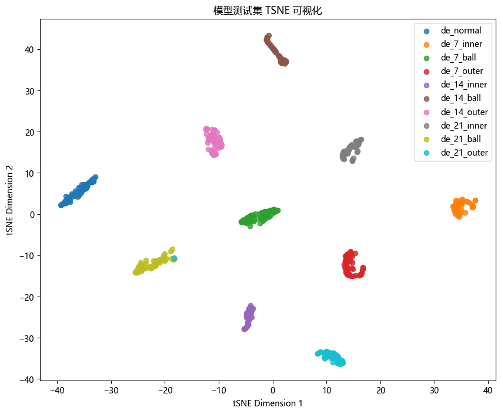
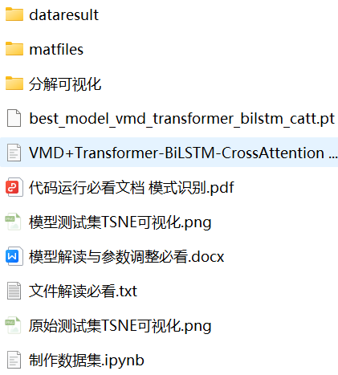

# Fault Classification Model Based on VMD+Transformer-BiLSTM-CrossAttention

Major Update! Failure Classification Model Based on VMD+Transformer-BiLSTM-CrossAttention
● Data Set: CWRU West Reserve University Bearing Data Set
● Environment Framework: Python 3.9, PyTorch 2.1 and above versions can run
● Accuracy: Test set achieves 99% accuracy
● User Requirements: For papers or graduation projects requiring data analysis
● Code Guarantee: The code is detailed with comments for immediate compatibility.
Note: We also provide a model explanation (for network structure learning) and parameter tuning guidance! For those needing a graduation project or writing a paper, this is essential. The module is rich, innovative, and highly performant!
Preface
This article is based on the CWRU bearing data, utilizing VMD to decompose complex signals into multiple intrinsic mode functions (IMFs), thereby transforming the raw signal into simpler sub-signals. Finally, the classification of fault data is achieved through a feature fusion model based on cross attention \tTransformer-BiLSTM-CrossAttention implemented in Python. A detailed introduction to the CWRU bearing data can be found in the following article:
Python-CWRU Bearing Data Interpretation and Classification Processing
1. Overall Model Structure
1.1 The overall model structure is as follows:
The original one-dimensional fault signal is decomposed by Variational Mode Decomposition (VMD). VMD separates the signal into a set of Intrinsic Mode Functions (IMFs), which represent the features at different frequency scales of the signal.
The advantage of VMD lies in its adaptability and its ability to process non-stationary signals, making the decomposed signal more conducive to feature extraction.
Through a Transformer-BiLSTM network, global and local temporal features are extracted. Finally, the cross attention mechanism is used to fuse the temporal features. By calculating attention weights, the model can focus more on important features, enhancing both model performance and generalization capabilities.
1.2 Innovation Points in-depth introduction:
(1) Multimodal feature extraction: Through VMD decomposition, the model can extract features from signals of different modalities, reducing redundant information and enhancing the effectiveness of features;
(2) Combination of Transformer and BiLSTM: By combining the global feature extraction capability of Transformer with the temporal feature extraction capability of BiLSTM, the model can capture more comprehensive complex features of signals:
Transformer: Proficient in capturing long-range dependencies and temporal information. The multi-head attention mechanism of Transformer can effectively extract global features from signals;
BiLSTM (Bidirectional Long Short-Term Memory Network): By simultaneously utilizing forward and backward LSTM units, BiLSTM can capture bidirectional sequential dependencies of signals, enhancing feature extraction capabilities;
(3) CrossAttention for feature fusion: Using cross attention for fusion of temporal features, it can effectively integrate information from different feature extractors, improving classification accuracy.
2 Preprocessing of bearing fault data
2.1 Importing data
Refer to previous articles for preprocessing of fault classification, using the Case Western Reserve University bearing data set for fault classification:
train_set, val_set, test_set are divided into training set, validation set, and test set according to a ratio of 7:2:1, and finally save the data.
2.2 Visualization of fault VMD decomposition
2.3 Preparation of fault data feature preprocessing dataset
3 Cross Attention Mechanism
3.1 Concept of Cross attention
Cross attention is an attention mechanism mixed in Transformer architecture that combines two different embedding sequences.
Both sequences must have the same dimensionality.
The two sequences can be of different modalities (such as text, sound, image).
A sequence as input defines the output sequence length, and another sequence provides the input K&V.
3.2 Cross-attention Algorithm
\tCalculate K and V for S1.
Calculate Q for S2
\tCalculate the Attention Matrix Based on K and Q
\tApply V to the Attention Matrix
The output sequence length is consistent with S2.
\t  
During the fusion process, we use the global temporal features of the Transformer as the query sequence and the local temporal features output by BiLSTM as key-value pairs. By calculating the attention weights between the query sequence and the key-value pairs sequence, we can model the degree of association between different features.
4. Bearing Fault Diagnosis Classification Based on VMD+Transformer-BiLSTM-CrossAttention
4.1 Set parameters and train the model
50 epochs, with an accuracy of 99%, the VMD+Transformer-BiLSTM-CrossAttention network significantly improves classification performance. The innovative model effectively extracts time-series features from bearing fault signals, achieving rapid convergence and superior performance. The high accuracy is due to the cross attention mechanism's ability to model the correlation between different features, extracting critical features for model recognition, resulting in significant improvements.
4.3 Model Evaluation
(1) Accuracy, Precision, Recall, F1 Score
(2) Fault classification confusion matrix:
(3) Classification Label Visualization
\t  
(4) Original Data t-SNE Feature Visualization
(5) t-SNE feature visualization after model training:
\t  
Click to download: Complete original data, Python code
Previously Featured Content:
Python-Case Western Reserve University (CWRU) Bearing Data Interpretation and Classification Process
Python Bearing Fault Diagnosis (Part 1): Short-Time Fourier Transform (STFT)
Python Bearing Fault Diagnosis (Part 2): Continuous Wavelet Transform (CWT)
Python Bearing Fault Diagnosis (Part 3): Empirical Mode Decomposition (EMD)
Pytorch-LSTM Bearing Fault One-Dimensional Signal Classification (Part 1)
Pytorch-CNN Bearing Fault One-Dimensional Signal Classification (Part 2)
Pytorch-Transformer Bearing Fault One-Dimensional Signal Classification (Part 3)
Python Bearing Fault Diagnosis (Part 4): Fault Classification Based on EMD-CNN
Python Bearing Fault Diagnosis (Part 5): Fault Classification Based on EMD-LSTM
Python Bearing Fault Diagnosis (Part 6): Fault Classification Based on EMD-Transformer
Python Bearing Fault Diagnosis (Part 7): Fault Classification Based on EMD-CNN-LSTM
Python Bearing Fault Diagnosis (Part 8): Fault Classification Based on EMD-CNN-GRU Parallel Model
Bearing Fault Identification Model Based on FFT + CNN - BiGRU-Attention: Attention Fusion of Time and Frequency Features
Bearing Fault Identification Model Based on FFT + CNN - Transformer: Attention Fusion of Time and Frequency Features
Python Bearing Fault Diagnosis (Part 9): Fault Classification Based on VMD+CNN-BiLSTM
Python Bearing Fault Diagnosis (Part 10): Fault Classification Based on VMD+CNN-Transformer
Python Bearing Fault Diagnosis (Part 11): Fault Classification Based on VMD+CNN-BiGRU-Attenion
Cross Attention Fusion of Time and Frequency Features: Bearing Fault Identification Model Based on FFT + CNN - BiLSTM-CrossAttention
Cross Attention Fusion of Time-Domain and Frequency-Domain Features for Bearing Fault Identification Model with FFT + CNN-Transformer
Introduction to Python Bearing Fault Diagnosis
Python Bearing Fault Diagnosis (13) Super Machine Learning Recognition Model Based on Fault Signal Feature Extraction
Python Bearing Fault Diagnosis (14) Highly Innovative Fault Recognition Model
Python Bearing Fault Diagnosis (15) One-Dimensional Fault Signal Recognition Model Based on CNN-Transformer
Python Bearing Fault Diagnosis (16) Highly Innovative Fault Recognition Model (II)
 | Sci-Tech 1st Class Innovation in Bearing Fault Diagnosis Model!
Python Bearing Fault Diagnosis (18) Innovative Diagnosis Model Based on CNN-TCN-Attention
Based on GADF+Swin-CNN-GAM Highly Innovative Bearing Fault Diagnosis Model
Attention Magic Modification | Super Bearing Fault Diagnosis Model!
Bearing Fault—Innovative Cross Attention Model Full Set
Python Bearing Fault Diagnosis (19) Innovative Diagnosis Model Based on Transformer-BiLSTM
END

## Images

<!-- PAYMENT_BLOCK -->

## Get this dataset

- Payment link (Stripe): [Buy now](https://buy.stripe.com/3cs8yP7sY87d0vu9AB)
- Payment QR code: 

<!-- /PAYMENT_BLOCK -->
